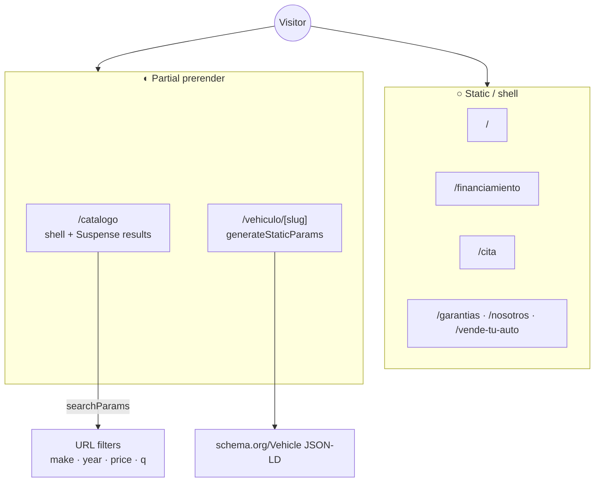
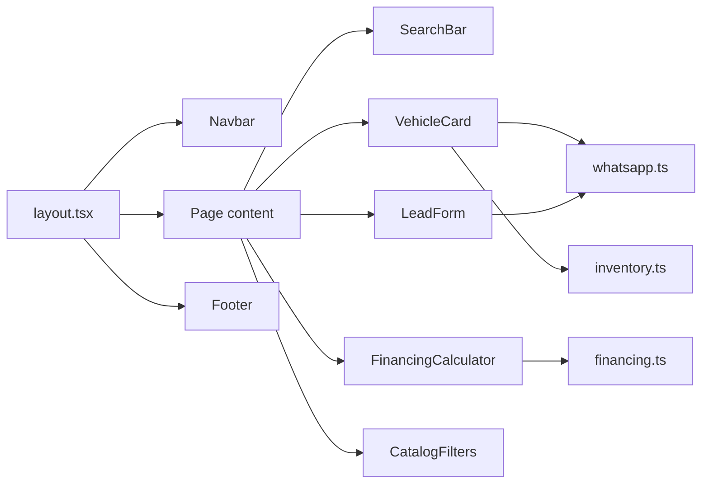

# Technical architecture

## Stack snapshot

- **Next.js 16.4** App Router (React 19, TypeScript)
- **Tailwind CSS v4** via `@tailwindcss/turbopack`
- **Manrope** (Google Fonts) weights 400–800
- **Cache Components** + partial prerendering enabled in `next.config.ts`
- Inventory currently **typed mock data** in `src/data/inventory.ts` (API-ready shape)

## Directory layout

```
src/
  app/                 Routes (App Router pages)
  components/          UI + domain components
  data/                Inventory seed / adapters
  lib/                 Types, financing math, WhatsApp helpers, formatters
public/                Logo and static assets
docs/                  This documentation
```

## Route rendering model



## Component map



## Data model (`Vehicle`)

| Field | Type | Notes |
| --- | --- | --- |
| `id` / `slug` | string | Stable URL key |
| `make` / `model` / `year` | string / string / number | Display + SEO |
| `price` | number | MXN integer |
| `mileage` | number | Kilometers |
| `transmission` / `exteriorColor` / `bodyType` | string | Specs |
| `guaranteed` | boolean | GARANTIZADO badge |
| `status` | `Available` \| `Sold` | Listing gate |
| `images` | string[] | Remote Autosell CDN URLs |
| `description` | string | Detail / JSON-LD |

## SEO conventions

Per `.cursorrules`:

- Emit **JSON-LD** `schema.org/Vehicle` on detail pages (`VehicleJsonLd`)
- Include `offers.priceCurrency = MXN`, mileage, model year, brand
- Prefer explicit image aspect ratios to avoid CLS
- Lazy-load below-the-fold gallery images

## Lead channel contract

```
https://wa.me/526142274381?text=<urlencoded Spanish message>
```

Canonical vehicle interest copy:

> Hola, estoy interesado en el vehículo: {Make} {Model} {Year} ({Price})

Implemented in `src/lib/whatsapp.ts`.

## Financing engine

`estimateMonthlyPayment(price, downPaymentPercent, termMonths, annualRate = 0.15)`

- Enganche range: **10%–50%**
- Plazos: **12 / 24 / 36 / 48 / 60** months
- Standard amortization formula with reference annual rate **15%\*** (informational, not a binding quote)

## Environment & scripts

| Script | Purpose |
| --- | --- |
| `npm run dev` | Local Turbopack server |
| `npm run build` | Production build + typecheck |
| `npm run start` | Serve production build |
| `npm run lint` | ESLint (Next config) |

Remote images allowlist: `www.autosell.mx` / `autosell.mx` under `/public/**`.
