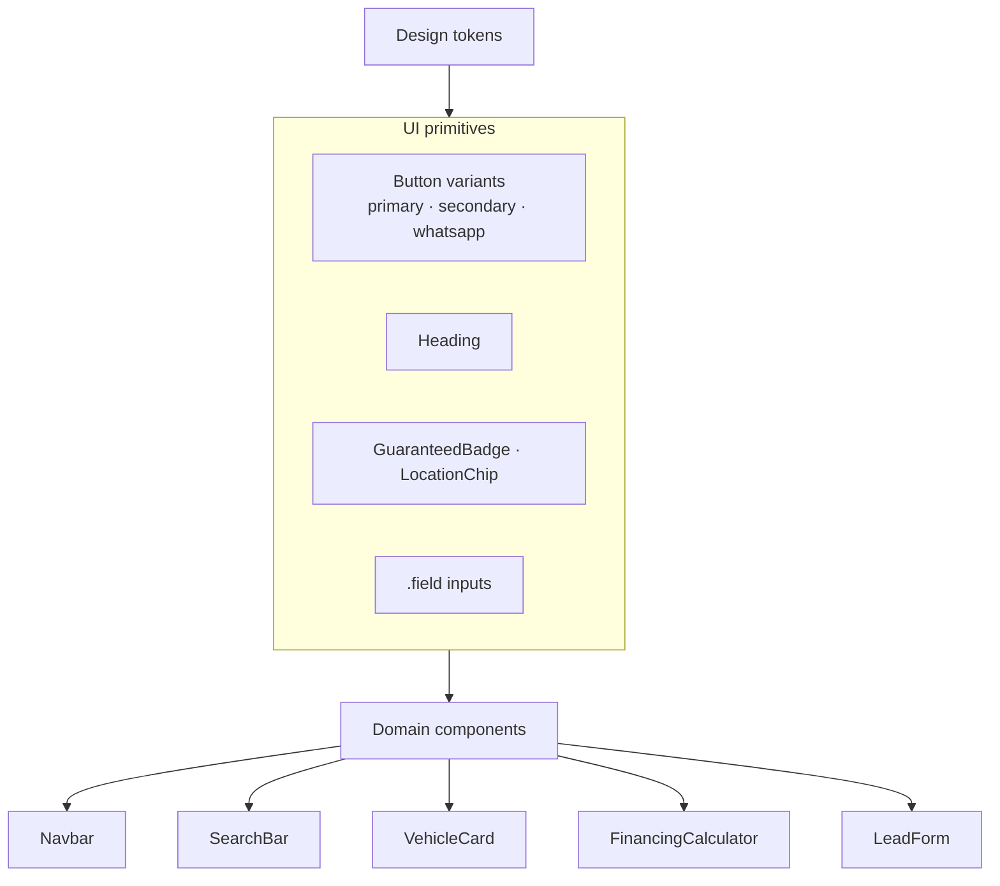

# Brand system

Source of truth: Autosell identidad visual (Borrador 1) + tokens in `src/app/globals.css`.

## Color tokens

| Name | Hex | CSS / Tailwind | Usage |
| --- | --- | --- | --- |
| Marino profundo | `#061630` | `--brand-bg` / `brand-bg` | Page background |
| Marino superficie | `#082347` | `--brand-surface` / `brand-surface` | Cards, panels, forms |
| Borde azul | `#1B3A6B` | `--brand-border` / `brand-border` | 1px outlines |
| Blanco | `#FFFFFF` | white | Primary text / headers |
| Texto secundario | `#B7C6E0` | `--brand-muted` / `brand-muted` | Labels, body support |
| Azul Autosell | `#2B9FEA` | `--brand-accent` / `brand-accent` | One-word headline highlights |
| Rojo Autosell | `#D81F26` | `--brand-red` / `brand-red` | Primary CTAs |
| Verde WhatsApp | `#5BD26F` | `--brand-whatsapp` / `brand-whatsapp` | WhatsApp triggers only |

## Typography

- **Family:** Manrope via `next/font/google`
- **Weights:** 400 Regular, 500 Medium, 600 Semibold, 700 Bold, 800 ExtraBold
- **Headlines:** ExtraBold + `tracking-tight`
- **Rule of one blue word:** `Heading` highlights exactly one impact word in `#2B9FEA`

### Scale (from identity guide)

| Role | Approx size | Weight |
| --- | --- | --- |
| Titular principal | 64 / responsive 4xl–6xl | ExtraBold |
| Título de sección | 40 / 3xl–4xl | ExtraBold |
| Nombre de auto | 22 | Bold |
| Texto de lectura | 14 | Regular |
| Etiqueta | 13 caps | Bold |

## Shape language

| Element | Rule |
| --- | --- |
| Inventory / form cards | Surface `#082347`, border 1px `#1B3A6B`, radius **24px** |
| Search bar | Pill (`rounded-full`) with nested red Buscar |
| Primary / WhatsApp buttons | Pill (`rounded-full`), min touch ~44px (`min-h-11`) |
| GARANTIZADO badge | Small red rounded rectangle, not a pill |

## Component ↔ brand mapping

## Do / don’t

| Do | Don’t |
| --- | --- |
| One blue word per major heading | Highlight entire phrases in accent blue |
| Red for decide actions | Use green for non-WhatsApp CTAs |
| Green only for WhatsApp | Mix WhatsApp green into finance/catalog primaries |
| Fine navy borders on cards | Heavy multi-layer shadows / purple gradients |
