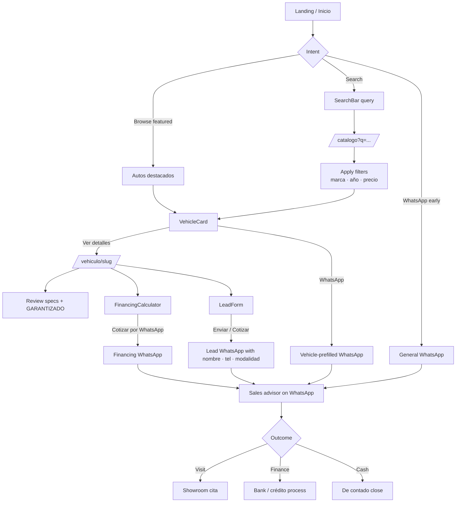
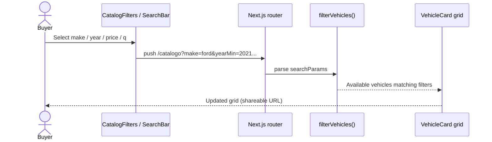
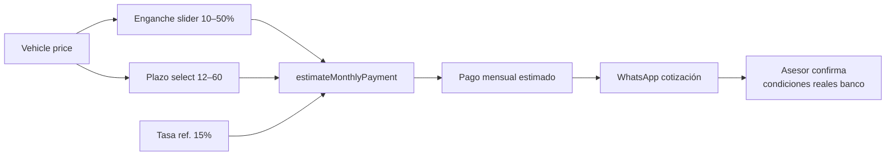
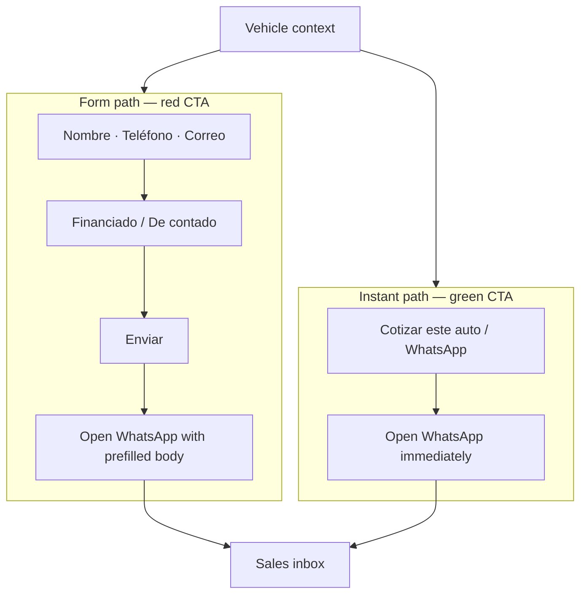
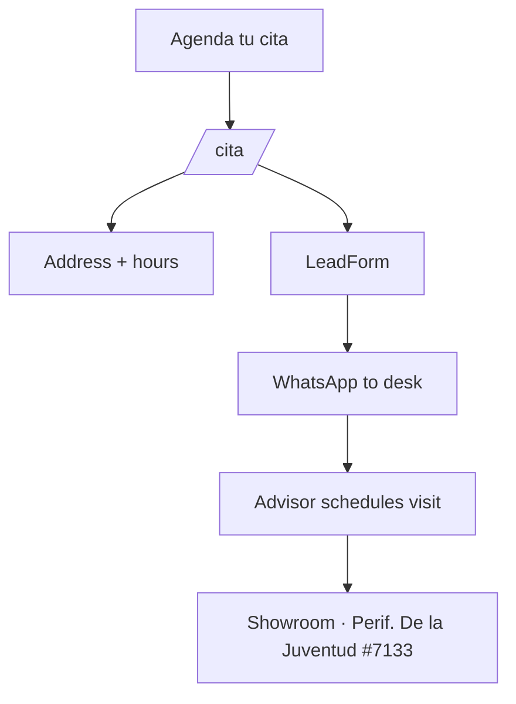
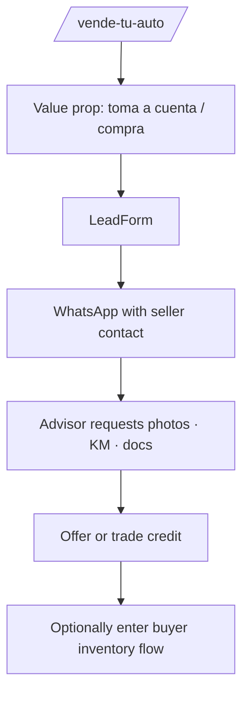
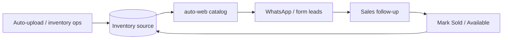

# Business flows

End-to-end journeys for Autosell.MX buyers, sellers, and the sales desk.

## 1. Buyer discovery → conversion

## 2. Catalog filtering (shareable state)

## 3. Financing simulation → sales handoff

## 4. Lead generation dual path

## 5. Appointment / showroom visit

## 6. Sell / trade-in intake

## 7. Internal ops loop (target state)

Current site uses static inventory seed. Intended future loop:

## Role of color in the funnel

| Color | Hex | Business meaning |
| --- | --- | --- |
| Rojo Autosell | `#D81F26` | Decide — catalog, cita, Enviar |
| Verde WhatsApp | `#5BD26F` | Converse — human sales channel |
| Azul Autosell | `#2B9FEA` | Emphasize — one key word per headline |
