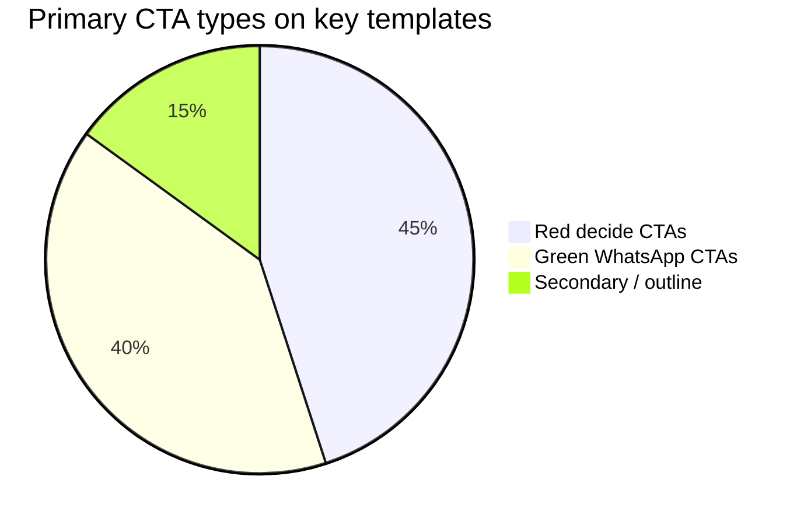

# Stats

Snapshot as of **2026-11-07** (documentation publish). Re-measure after major releases.

## Repository

| Metric | Value |
| --- | --- |
| Tracked source files (`src/**/*.ts(x)`) | 27 |
| Approximate LOC in `src` | ~1,940 |
| App routes (user-facing) | 8 (+ dynamic `/vehiculo/[slug]`) |
| Shared components | 14 |
| Lib modules | 5 (`types`, `format`, `financing`, `whatsapp`, `cn`) |
| Seed inventory vehicles | 8 |
| Git commits at docs publish | 2 (+ docs commit) |
| Package name | `autosell-web` `0.1.0` |

## Product surface

| Area | Count / detail |
| --- | --- |
| Nav items | 6 (+ Agenda tu cita CTA) |
| Brand color tokens | 8 |
| Button variants | 4 (`primary`, `secondary`, `whatsapp`, `ghost`) |
| Financing plazos | 5 (12–60 months) |
| Enganche range | 10%–50% |
| Reference APR | 15%\* informational |
| WhatsApp E.164 | `526142274381` |
| Price currency | MXN |

## Route inventory

| Route | Role |
| --- | --- |
| `/` | Hero, search, destacados, financing teaser, lead |
| `/catalogo` | Filtered inventory (PPR + Suspense) |
| `/vehiculo/[slug]` | Detail, calculator, lead, JSON-LD |
| `/financiamiento` | Dedicated simulator |
| `/cita` | Appointment intake |
| `/garantias` | Trust content |
| `/nosotros` | About / contact |
| `/vende-tu-auto` | Seller intake |

## Build / runtime

| Check | Status (initial delivery) |
| --- | --- |
| `npm run build` | Pass (Next 16.4 Turbopack) |
| Cache Components | Enabled |
| Partial prefetching | Enabled |
| Homepage smoke | HTTP 200 |
| Catalog smoke | HTTP 200 |
| Vehicle detail smoke | HTTP 200 |
| Image proxy (Autosell CDN) | HTTP 200 for `/public/uploads/catalogo/**` |

## Conversion surfaces

*Pie is illustrative of UI emphasis, not traffic analytics.*

## Inventory seed price band

| Stat | Approx (seed data) |
| --- | --- |
| Min list price | $160,000 MXN |
| Max list price | $1,890,000 MXN |
| Body types represented | Pickup, SUV, Hatchback |
| Guaranteed flag | 100% of seed listings |
