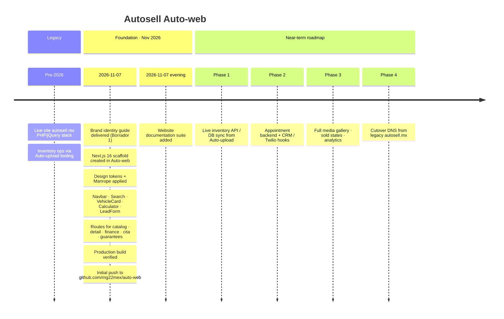

# Timeline

Project history for **auto-web** (Autosell.MX website replacement) and planned next phases.

## Chronology

## Milestone table

| When | Milestone | Evidence |
| --- | --- | --- |
| Pre-project | Legacy public site online | autosell.mx |
| 2026-11-07 | Identity guide locked (colors, Manrope, card/pill rules) | Brand PDF → tokens in `globals.css` |
| 2026-11-07 | App scaffold + core sales UI | Commit `404f729` |
| 2026-11-07 | GitHub remote established | `origin` → `mg22mex/auto-web` |
| 2026-11-07 | Documentation published | `docs/*` (this suite) |

## Git history (repo)

| Commit | Summary |
| --- | --- |
| `75192e1` | Initial commit from Create Next App |
| `404f729` | Build Autosell.MX site with brand tokens and core sales components |

## Roadmap detail

### Phase 1 — Inventory truth
- Replace `src/data/inventory.ts` seed with API/DB
- Keep `Vehicle` type and JSON-LD contract
- Cascading make → model filters (per `.cursorrules`)

### Phase 2 — Lead operations
- Persist LeadForm submissions (not only WhatsApp open)
- Optional Twilio / CRM sync
- Cita calendar or Monday.com / Slack alerts

### Phase 3 — Experience depth
- Multi-image galleries with aspect-ratio grids
- Sold overlays / waitlist
- Analytics (search queries, calculator engagement, WA click-through)

### Phase 4 — Cutover
- Staging parity check vs legacy catalog
- SEO redirects from old vehicle URLs
- DNS / CDN switch to Next deployment
