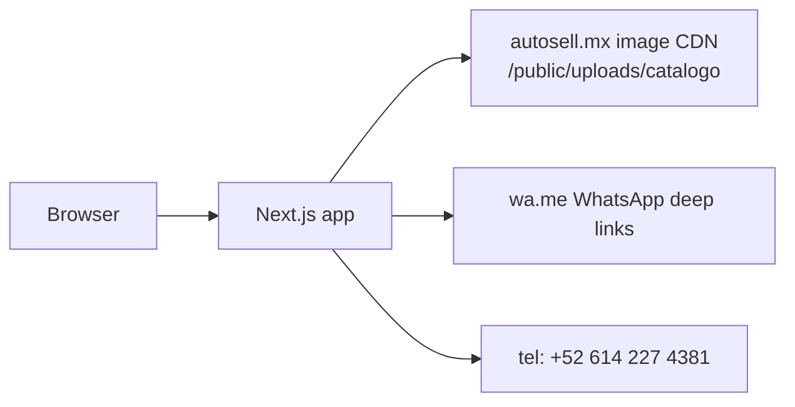

# Tools & workflow

## Application stack

| Layer | Tool | Version / notes |
| --- | --- | --- |
| Framework | Next.js | 16.4.5 (App Router, Turbopack) |
| UI library | React / React DOM | 19.3.0 |
| Language | TypeScript | 5.x |
| Styling | Tailwind CSS | v4 + `@tailwindcss/turbopack` |
| Fonts | `next/font` → Manrope | 400–800 |
| Lint | ESLint + `eslint-config-next` | 9.x |
| Images | `next/image` | Remote Autosell CDN allowlist |
| Package manager | npm | lockfile committed |

## Development commands

```bash
npm install
npm run dev      # http://localhost:3000
npm run build    # production compile + types
npm run start    # serve .next
npm run lint
```

## Platform & collaboration

| Purpose | Tool |
| --- | --- |
| Source control | Git + GitHub (`mg22mex/auto-web`) |
| IDE / agent | Cursor |
| Agent rules | `.cursorrules`, `AGENTS.md` (Next 16 docs pointer) |
| Memory / context | Claude-mem (when Chroma online) |
| Design source | Autosell identidad visual PDF |
| Legacy reference | Live [autosell.mx](https://autosell.mx) |
| Sibling ops | `/Extra/Yandex.Disk/Autosell/Auto-upload` inventory tooling |

## External services (current)



| Service | Integration today |
| --- | --- |
| WhatsApp | Client deep links only (no Business API yet) |
| Phone | `tel:` links |
| Inventory images | Hotlinked from legacy CDN |
| CRM / email | Not wired — WhatsApp is the lead sink |

## Recommended additions (roadmap)

| Need | Candidate tools |
| --- | --- |
| Hosting | Vercel / Cloudflare / Oracle (existing Autosell infra) |
| Inventory DB | Postgres / existing dump `autosellmx.dump` |
| Observability | Vercel Analytics, Plausible, or GA4 |
| Forms backend | Server Actions + Resend / Twilio |
| Design QA | Playwright MCP / Chromatic |
| Project tracking | GitHub Issues / Monday.com |

## Coding standards (enforced in repo)

From `.cursorrules`:

1. JSON-LD `Vehicle` on listing/detail surfaces  
2. Strict `Vehicle` typing  
3. Filters mirrored in URL search params  
4. Standardized WhatsApp interest message template  
5. Explicit aspect ratios + lazy-load for media

## Local notes

- Yandex Disk sync can slow `node_modules` I/O; prefer installing on a non-synced volume if builds stall.
- `.brand/` PDF page renders are gitignored (local design reference only).
